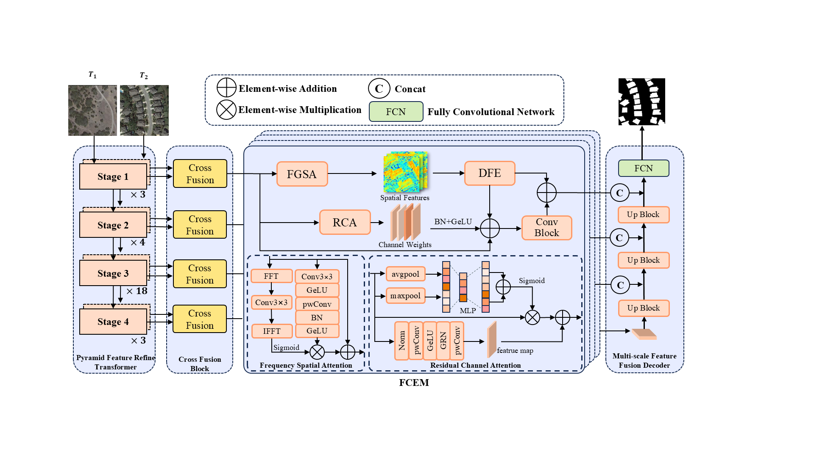
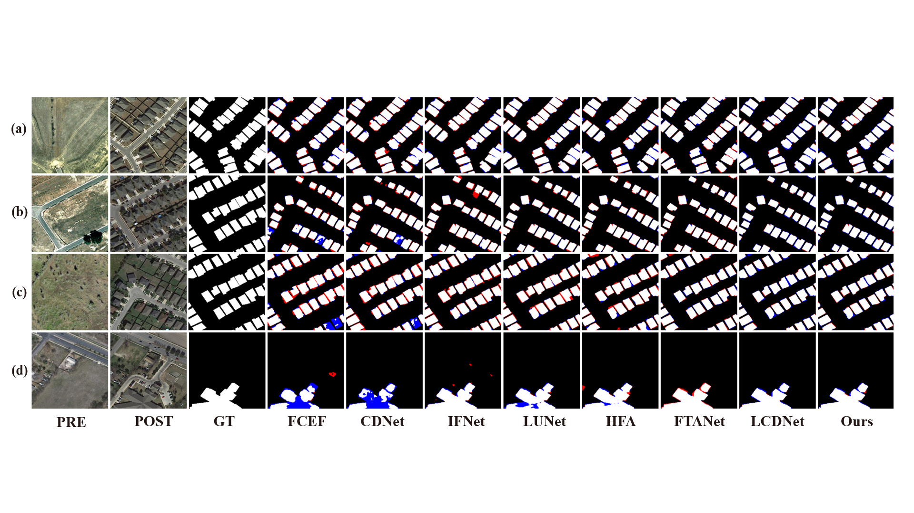
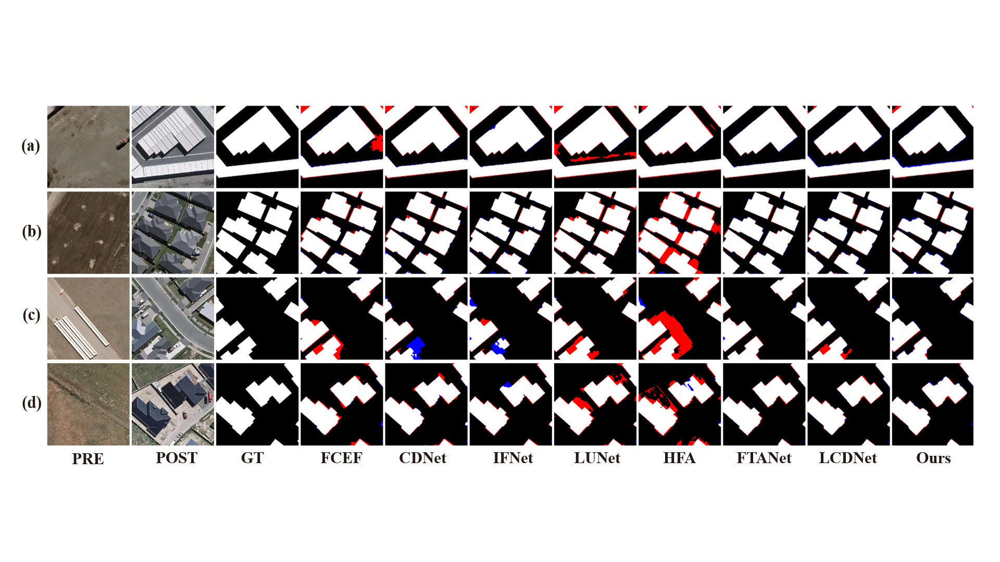
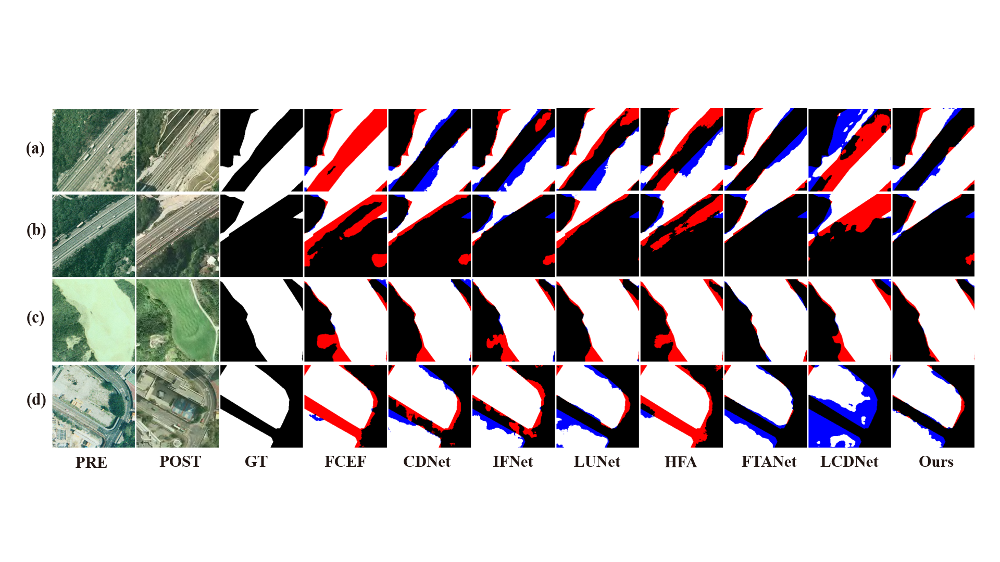

# Hierarchical Cross-Temporal Frequency Network for Remote Sensing Building Change Detection

⭐ The code of HCTFNet has been completely released ⭐ 

## To Train 

 ```
python train.py 
 ```

## To Test

1. Downloading the pre-trained checkpoint from [best_model.pt](https://pan.baidu.com/s/1oS0fSBS0DI6nYCFMdzXGPQ?pwd=5gax) and set the "dataset-dir" configuration parameter to the path of the downloaded file.
2. python test.py

## overall network

<p align="center">  </p>

## Results

### LEIVR-CD Datasset

#### Qualitative result

<p align="center">  </p>

- Four representative images of the LEVIR-CD test set.

#### Quantitative Results

| **Method**  | **Precision** | **Recall** |  **F1**   | **mIoU**  |
| :---------: | :-----------: | :--------: | :-------: | :-------: |
|    FC-EF    |     79.91     |   82.84    |   81.35   |   81.97   |
|    CDNet    |     84.21     |   87.10    |   85.63   |   85.65   |
|    IFNet    |     85.37     |   90.24    |   87.74   |   87.53   |
|    LUNet    |     85.69     |   90.99    |   88.73   |   88.44   |
|   BITNet    |     87.32     |   91.41    |   89.32   |   89.00   |
|   HFANet    |     83.36     |   91.47    |   87.23   |   87.03   |
|   SNUNet    |     91.05     |   88.87    |   89.94   |   89.65   |
|   FTANet    |     90.75     | **93.04**  |   91.88   |   91.61   |
|   LCDNet    |   **94.02**   |   87.69    |   90.74   |   83.06   |
| **HCTFNet** |     93.02     |   91.18    | **92.10** | **91.80** |


###  WHU-CD Datasset

#### Qualitative result

<p align="center">  </p>

- Four representative images of the WHU-CD test set.

#### Quantitative Results

| **Method**  | **Precision** | **Recall** |  **F1**   | **mIoU**  |
| :---------: | :-----------: | :--------: | :-------: | :-------: |
|    FC-EF    |     70.43     |   83.31    |   79.90   |   82.12   |
|    CDNet    |     81.75     |   88.69    |   85.08   |   86.25   |
|    IFNet    |     86.51     |   87.69    |   87.09   |   87.93   |
|    LUNet    |     66.32     | **93.00**  |   77.45   |   80.26   |
|   BITNet    |     82.35     |   92.59    |   87.17   |   87.96   |
|   HFANet    |     74.19     |   89.56    |   81.15   |   83.12   |
|   SNUNet    |     81.92     |   85.33    |   83.59   |   85.08   |
|   FTANet    |   **93.17**   |   85.01    |   88.90   |   89.49   |
|   LCDNet    |     90.83     |   88.31    |   89.55   |   81.08   |
| **HCTFNet** |     90.95     |   88.24    | **89.58** | **90.06** |

### SYSU-CD Dataset

#### Qualitative result

<p align="center">  </p>

- Four representative images of the SYSU-CD test set.

#### Quantitative Results

| **Method**  | **Precision** | **Recall** |  **F1**   | **mIoU**  |
| :---------: | :-----------: | :--------: | :-------: | :-------: |
|    FC-EF    |     64.58     | **89.79**  |   75.13   |   71.19   |
|    CDNet    |     74.61     |   84.10    |   79.08   |   76.15   |
|    IFNet    |     75.29     |   87.60    |   80.98   |   77.91   |
|    LUNet    |     76.14     |   81.74    |   78.84   |   78.84   |
|   BITNet    |     80.91     |   79.29    |   79.95   |   77.53   |
|   HFANet    |     73.66     |   85.00    |   78.92   |   75.89   |
|   SNUNet    |     76.90     |   79.59    |   78.22   |   75.68   |
|   FTANet    |   **86.13**   |   80.39    | **83.16** | **80.85** |
|   LCDNet    |     76.42     |   68.36    |   72.17   |   56.45   |
| **HCTFNet** |     82.16     |   83.94    |   80.10   |   77.92   |

If you have any questions, please contact me by email (evan15972207735@outlook.com).
